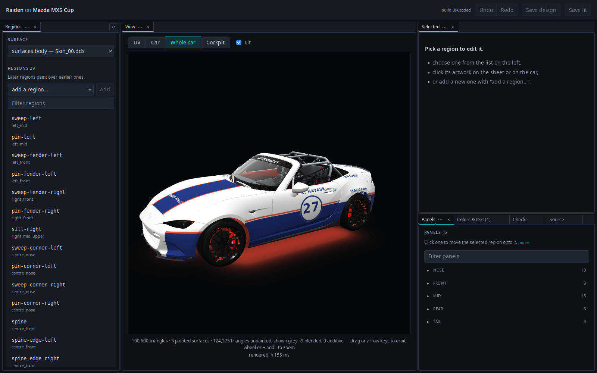
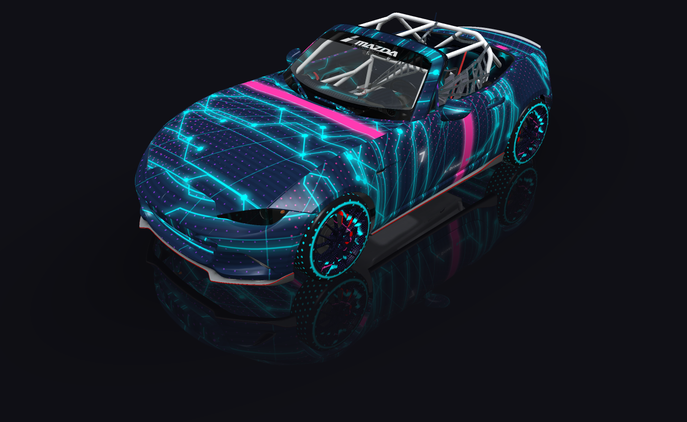

# liverykit

[](https://github.com/mishan/liverykit/actions/workflows/ci.yml)

Generate [Assetto Corsa](https://www.assettocorsa.net/) car liveries from code.



*The fitting editor: a design described as named regions over a palette, fitted onto the car's own model.*

```sh
npm install
node bin/liverykit.mjs neon-grid
# -> dist/neon_grid.zip — drag it onto Content Manager to install
```

Assetto Corsa 1 only. Competizione uses an unrelated skin system.

The example is written for the Tatuus FA01, which comes with the base game, so
the skin installs on any copy of Assetto Corsa.

---

## Why not just paint a texture?

Emitting a good-looking 2048×2048 image is the easy part. The hard part is that
**nothing in the texture tells you which bit of it lands on the sidepod.**

Coordinates in a texture are just fractions of an image. The mapping from those
fractions onto bodywork lives in the car's 3D model, and it is not evenly
spaced, not symmetric, and not guessable. Get it wrong and a sponsor name walks
off the edge of a *UV island* — a contiguous patch of texture that maps to one
region of bodywork — halfway through the word. Perfect in the texture, broken on
the car.

liverykit reads the car's model to find out. A `.kn5` (Assetto Corsa's model
format) stores a 3D position *and* a UV coordinate for every vertex, which is
precisely the mapping a livery needs.



---

## How it works

Four layers, deliberately separate:

| | what it describes | |
|---|---|---|
| **car profile** — `cars/*.json` | what a *car* is: its textures, and its UV islands given names and measurements | generated once per car, identical for everyone who owns it — **worth sharing** |
| **livery** — `liveries/*.mjs` | what a *design* is: palette, identity, and which **treatment** (a function that fills a rectangle with art) goes on which named **panel** (a named UV island) | quick to write, this is the fun part |
| **fit** — `fits/*.json` | where one design's artwork sits on one particular car | belongs to the pair, not to either half — see [the guide](docs/guide.md#fitting-a-portable-design-to-one-car) |
| **pack** — `src/packs/*.mjs` | what a *style* is: the treatments themselves | bring your own without forking |

Because a livery names panels instead of coordinates:

```js
{ treatment: 'fill', panel: 'nose', at: [0, 0, 1, 0.4] }
```

reads *"the front 40% of the nose"* — and keeps meaning that if you point the
same design at a different car with `--profile`. Absolute coordinates still work
as an escape hatch for anything unmapped.

The editor makes that choice visible. A region can name **this car's panel** or
name **tags** — `left`, `mid` — and switch between them, with a live count of how
many panels the selection lands on. **On another car** then checks the whole
design against any other profile you have and names the regions that would find
nothing there. Neither needs a model or a game install: a profile is the whole of
what liverykit knows about a car.

---

## Install

```sh
npm install
```

Node 20.9 or newer — that is what sharp's prebuilt binaries require, so it is
the real floor rather than a preference. Three npm dependencies — `sharp`, which
ships prebuilt binaries so there's no build toolchain, `colord`, which is 8 KB
and has none of its own, and `ac-cardata`, which reads a car's own `car.ini` for
where its driver sits. Nothing else: DDS textures are encoded in JavaScript.

Text is drawn in the first installed font of the livery's `render.font`. The
examples ask for `DejaVu Sans, Verdana, sans-serif`: DejaVu on Linux, Verdana,
which is near enough the same width, on Windows and macOS. A font that is not
installed is passed over without a word, so name a fallback.

### You supply the game's files

This repository contains no car models, textures or skins, and never will: they
belong to the people who made the cars. What it ships are **profiles** —
measurements about a car, a few hundred lines of JSON each — which is why the two
bundled examples build without you owning anything.

Profiles for the rest of the cars that come with the game live in
[liverykit-profiles](https://github.com/mishan/liverykit-profiles). Point
liverykit at a checkout, and a design or `--profile` can name any of them by id:

```sh
git clone https://github.com/mishan/liverykit-profiles
node bin/liverykit.mjs neon-grid-any --profile ks_ferrari_488_gt3 --profiles liverykit-profiles/cars
# or set LIVERYKIT_PROFILES once instead of passing --profiles
```

Profiles are looked for in `./cars/`, then there, then among the bundled ones.

Anything that has to read a car reads it from *your* installation:

| | needs |
|---|---|
| building a livery on a bundled profile | nothing |
| `--from-kn5`, `--explain` | the car's `.kn5`, path given explicitly |
| `--ui`, the 3D views | the car's `.kn5`, found or given |
| `--scan`, `--skins` | a `skins/` folder from the car |

Tell it where your install is once and the rest follows:

```sh
export AC_ROOT="$HOME/.steam/steam/steamapps/common/assettocorsa"
# Windows: C:\Program Files (x86)\Steam\steamapps\common\assettocorsa
```

`--ui` searches `$AC_ROOT`, then `$ASSETTOCORSA`, then this checkout under
`content/cars/<car>/` or `cars/<car>/` — so unpacking a car into the repo works
too, and both paths are gitignored. If it finds nothing it says so and lists
every path it tried; the UV editor still works without a model, and only the Car
tabs are unavailable.

*Developed on Linux; CI tests and builds on Linux and Windows, where the game
runs.*

---

## Documentation

- [Guide](docs/guide.md): making a livery, from a car's profile to a skin in
  the game — portable designs, fits and the fitting editor, decals, spanning
  regions, constraints, and writing your own treatments.
- [Reference](docs/reference.md): the command line, the car profile's fields,
  and the MCP tools.
- Automation: an [MCP server](docs/reference.md#model-context-protocol-mcp)
  lets an agent read the car, check a draft and propose changes for a person to
  accept; [autolivery](https://github.com/mishan/autolivery) is one built on it.
- Why things are the way they are: [fitting](docs/fitting.md),
  [spanning](docs/spanning.md), [naming and bindings](docs/naming.md),
  [the MCP server](docs/mcp.md), [calibration](docs/calibration.md).
- [docs/dev/](docs/dev/): the roadmap, the backlog and design plans.

---

## Contributing

Car profiles are the most valuable thing to contribute: one command produces one,
and it's identical for everyone who owns that car. See
[CONTRIBUTING.md](CONTRIBUTING.md), and [AGENTS.md](AGENTS.md) for how the code
is arranged and the Assetto Corsa behaviors it is defending against — every one
of which produces a file that installs cleanly and is wrong.

The kn5 reader is reverse-engineered from a format with no public specification.
It validates by consuming the file to its exact final byte, so a wrong layout
fails loudly instead of parsing into nonsense. If it throws on your car, please
[open an issue](https://github.com/mishan/liverykit/issues) with the version
number it prints.

---

## License

MIT. Not affiliated with Kunos Simulazioni or any car maker. Ships no game
assets, and profiles contain measurements only — never textures or models.
